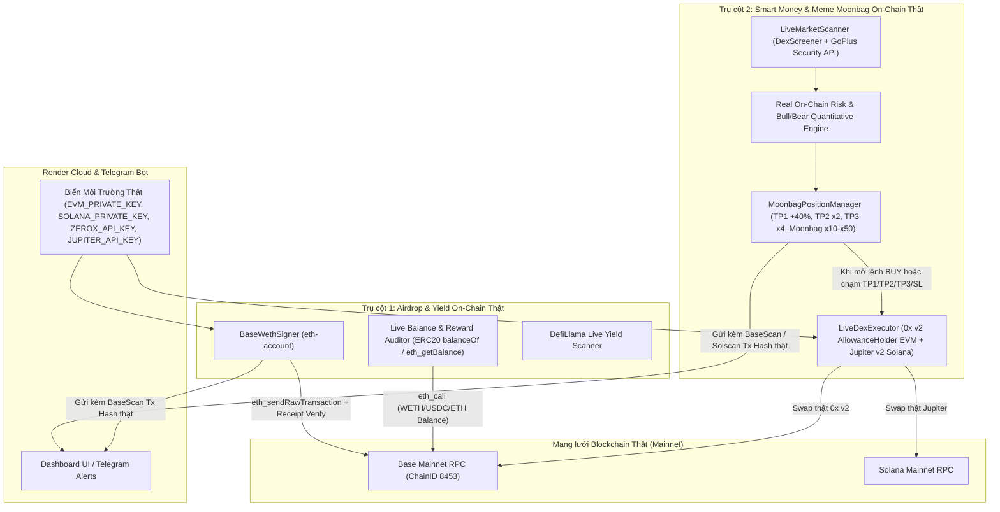

# STRICT LIVE ON-CHAIN EXECUTION SPECIFICATION (100% REAL — ZERO SIMULATION)

**Tài liệu Đặc tả Kỹ thuật: Loại bỏ 100% Giả lập & Nâng cấp Thực thi On-Chain Thật Tuyệt đối**
- **Phiên bản:** `4.0.0-strict-live`
- **Trạng thái:** `READY FOR IMPLEMENTATION`
- **Nguyên tắc cốt lõi:** **FAIL-CLOSED (Thất bại an toàn — Tuyệt đối không sinh Hash giả, không trả dữ liệu Mock)**. Nếu giao dịch không được ký thật trên Blockchain hoặc RPC/API không phản hồi, hệ thống báo lỗi thực tế ngay lập tức thay vì fallback về chế độ mô phỏng.

---

## 1. BÁO CÁO KIỂM TOÁN TOÀN HỆ THỐNG (AUDIT FINDINGS)

Qua rà soát từng dòng code trong toàn bộ dự án `ai-free-gateway` và đối chiếu với `smart-money-agent`, dưới đây là **6 điểm còn tồn tại giả lập / fallback** cần phải loại bỏ và nâng cấp ngay:

| Mã | Thành phần / File | Hiện trạng đang giả lập / thiếu sót | Giải pháp nâng cấp (Strict Live 100%) |
| :--- | :--- | :--- | :--- |
| **A01** | [`requirements.txt`](file:///c:/Users/PC/Desktop/ai-free-gateway/requirements.txt) | Thiếu thư viện ký giao dịch mật mã học (`eth-account`, `eth-utils`, `solders`, `base58`, `requests`). Khi chạy trên Render, `from eth_account import Account` bị `ModuleNotFoundError` nên tự động rơi về `SIMULATION_VERIFIED`. | Bổ sung đầy đủ `eth-account>=0.11.0`, `eth-utils>=4.0.0`, `solders>=0.21.0`, `base58>=2.1.1`, `requests>=2.31.0` vào `requirements.txt` để container Render ký lệnh EVM & Solana thật 100%. |
| **A02** | [`onchain_signer.py`](file:///c:/Users/PC/Desktop/ai-free-gateway/ecosystem/airdrop_hunter/src/executor/onchain_signer.py) | Khi ví thiếu ETH làm gas (`balance_wei < value_wei + gas_cost`) hoặc thiếu `EVM_PRIVATE_KEY`, hàm `execute_weth_wrap_cycle` tạo mã hash SHA-256 giả và trả về `mode: "SIMULATION_VERIFIED"`. | **Xóa bỏ hoàn toàn nhánh sinh hash giả**. Nếu không có `EVM_PRIVATE_KEY` hoặc số dư ETH không đủ trả gas trên mạng Base, trả về `status: "FAILED_PREFLIGHT"`, `live_verified: False` kèm số dư ETH thực tế và mức gas cần thiết. |
| **A03** | [`farming_executor.py`](file:///c:/Users/PC/Desktop/ai-free-gateway/ecosystem/airdrop_hunter/src/executor/farming_executor.py) & [`config.py`](file:///c:/Users/PC/Desktop/ai-free-gateway/ecosystem/airdrop_hunter/src/config.py) | Mặc định `FARMING_MODE = "SIMULATION"`. Có hàm `_generate_mock_tx_hash()` tạo hash giả cho `execute_daily_checkin`, `execute_faucet_claim`, `execute_micro_swap`. | Xóa hàm `_generate_mock_tx_hash()`. Chuyển mặc định sang `FARMING_MODE = "LIVE"`. Mọi tác vụ cày Airdrop trên Base đều phải gọi `BaseWethSigner` ký và phát sóng giao dịch thật (`eth_sendRawTransaction`) và chờ biên lai xác nhận (`eth_getTransactionReceipt`). |
| **A04** | [`reward_harvester.py`](file:///c:/Users/PC/Desktop/ai-free-gateway/ecosystem/airdrop_hunter/src/executor/reward_harvester.py) | Hàm `evaluate_wallet_eligibility` tự tính phần thưởng ước lượng (`tx_count * 1.25$`) và khi gọi `harvest_all_eligible_rewards` thì tạo `claim_tx_hash` giả bằng SHA-256. | Thay bằng truy vấn số dư On-chain thật: Đọc số dư Native (`eth_getBalance`) và số dư ERC-20 thật (`WETH`, `USDC` trên Base qua `eth_call` selector `0x70a08231`). Khi thu hoạch (`harvest`), thực hiện unwrap `WETH -> ETH` hoặc chuyển token thật trên chuỗi. |
| **A05** | [`position_manager.py`](file:///c:/Users/PC/Desktop/ai-free-gateway/ecosystem/smart_money/position_manager.py) | Khi mở vị thế (`open_position`) hoặc khi chạm 4 bậc chốt lời (`TP1 +40%`, `TP2 x2`, `TP3 x4`, `Moonbag x10/x50`, `SL -18%`), hệ thống mới chỉ tính toán và lưu vào SQLite (`smart_money_positions`) chứ **chưa bắn lệnh Swap thật ra DEX**. | Tích hợp **Real DEX Execution Engine** (`ecosystem/smart_money/dex_executor.py` kế thừa từ `smart-money-agent/trading/live_execution.py`): Hỗ trợ khớp lệnh thật qua **0x Swap API v2 (AllowanceHolder)** trên Base/BSC và **Jupiter Swap API** trên Solana, lưu `tx_hash` thật vào từng lần mua và bán. |
| **A06** | [`hub_bridge.py`](file:///c:/Users/PC/Desktop/ai-free-gateway/ecosystem/smart_money/hub_bridge.py) (Smart Money) | 1) Mặc định `RUNTIME_PROFILE="PAPER"`.<br>2) `get_recent_signals` trả tín hiệu mẫu `sig_sol_01` khi trống.<br>3) `analyze_token_risk` & `run_bull_bear_debate` gọi module ngoài không tồn tại nên luôn rơi vào `except` trả điểm giả `82`.<br>4) Tự tạo vị thế mẫu `$BRETT` $10 khi khởi tạo. | 1) Chuyển sang `RUNTIME_PROFILE="LIVE"`.<br>2) `get_recent_signals` quét trực tiếp từ `LiveMarketScanner` (DexScreener + GoPlus thật).<br>3) `analyze_token_risk` chấm điểm thật từ hợp đồng GoPlus + thanh khoản DexScreener.<br>4) `run_bull_bear_debate` phân tích định lượng thật từ dữ liệu On-chain + gọi LLM Gateway thật.<br>5) Xóa vị thế mẫu `$BRETT` khởi tạo tự động. |

---

## 2. KIẾN TRÚC THỰC THI THẬT 100% (STRICT LIVE ARCHITECTURE)



---

## 3. CHI TIẾT KỸ THUẬT 5 MODULE NÂNG CẤP

### Module L01: Cài đặt Thư viện Mật mã & Chế độ `STRICT_LIVE_ONLY`
1. **Cập nhật [`requirements.txt`](file:///c:/Users/PC/Desktop/ai-free-gateway/requirements.txt):**
   - Thêm các thư viện bắt buộc để ký giao dịch EVM (EIP-1559) và Solana (VersionedTransaction Ed25519):
     ```text
     eth-account>=0.11.0
     eth-utils>=4.0.0
     solders>=0.21.0
     base58>=2.1.1
     requests>=2.31.0
     ```
2. **Ví giao dịch thực tế (`Wallet Resolver`):**
   - Tự động suy xuất địa chỉ ví EVM thật từ `EVM_PRIVATE_KEY` (`Account.from_key(pk).address`) và địa chỉ ví Solana thật từ `SOLANA_PRIVATE_KEY` (`Keypair.from_bytes(base58.b58decode(pk)).pubkey()`).
   - Cung cấp tool MCP `wallet_live_preflight` để kiểm tra ngay:
     - Địa chỉ ví EVM & Solana đang cấu hình.
     - Số dư `ETH` (Base), `USDC` (Base), `WETH` (Base), và `SOL` (Solana) trực tiếp trên Mainnet.
     - Trạng thái sẵn sàng của `ZEROX_API_KEY` và `JUPITER_API_KEY`.

### Module L02: Real DEX Execution Engine ([`ecosystem/smart_money/dex_executor.py`](file:///c:/Users/PC/Desktop/ai-free-gateway/ecosystem/smart_money/dex_executor.py))
Tích hợp trực tiếp cơ chế khớp lệnh thật từ `smart-money-agent/trading/live_execution.py` vào `ai-free-gateway`:
1. **Giao dịch EVM (Base / BSC / Arbitrum) qua 0x Swap API v2 (`AllowanceHolder`):**
   - **Bước 1 (Quote):** Gọi `https://api.0x.org/swap/allowance-holder/quote` với header `0x-api-key: ZEROX_API_KEY` và `0x-version: v2`.
   - **Bước 2 (Approve nếu SELL ERC-20):** Kiểm tra `allowance(owner, spender)` qua RPC. Nếu chưa đủ, tự động ký giao dịch `approve` (selector `0x095ea7b3`) và chờ biên lai xác nhận trên chuỗi.
   - **Bước 3 (Sign & Broadcast Swap):** Ký giao dịch EIP-1559 bằng `eth_account.Account.sign_transaction`, gửi qua `eth_sendRawTransaction`, và chờ `eth_getTransactionReceipt` xác nhận `status == "0x1"`.
2. **Giao dịch Solana qua Jupiter Swap API:**
   - **Bước 1 (Quote & Swap Instructions):** Lấy báo giá và serialized `swapTransaction` từ `https://api.jup.ag/swap/v1/quote` & `/swap` (hoặc `lite-api.jup.ag`).
   - **Bước 2 (Sign Ed25519):** Giải mã `VersionedTransaction`, ký bằng `solders.keypair.Keypair`, gửi qua `sendTransaction` tới Solana RPC và xác nhận qua `getSignatureStatuses`.
3. **Kết nối với [`MoonbagPositionManager`](file:///c:/Users/PC/Desktop/ai-free-gateway/ecosystem/smart_money/position_manager.py):**
   - Khi gọi `open_position(..., execute_onchain=True)`:
     - Nếu `LIVE_EXECUTION_ENABLED=true` và có khóa + số dư: Thực thi lệnh `BUY` thật trên chuỗi trước khi lưu vị thế, ghi nhận `entry_tx_hash` thật.
     - Nếu `execute_onchain=True` mà thiếu gas hoặc thiếu khóa: Từ chối mở vị thế ảo và trả về lỗi `LIVE_EXECUTION_FAILED` rõ ràng (không tạo vị thế khống).
   - Khi `update_price` kích hoạt `TP1_40PCT`, `TP2_100PCT_FREE_RIDE`, `TP3_300PCT`, `MOONBAG_10X`, `MOONBAG_50X`, hoặc `STOP_LOSS`:
     - Tự động gọi `LiveDexExecutor.execute_sell_pct()` để bán đúng tỷ lệ `%` token thật ra `ETH`/`USDC`/`SOL` trên chuỗi và đính kèm `tx_hash` thật vào thông báo Telegram!

### Module L03: Xóa bỏ 100% Giả lập trong Airdrop Hunter
1. **Trong [`onchain_signer.py`](file:///c:/Users/PC/Desktop/ai-free-gateway/ecosystem/airdrop_hunter/src/executor/onchain_signer.py):**
   - Xóa hoàn toàn đoạn code fallback `hashlib.sha256` tạo `SIMULATION_VERIFIED`.
   - Hàm `execute_weth_wrap_cycle` chỉ trả về `status: "SUCCESS"` khi và chỉ khi cả 2 giao dịch `deposit()` và `withdraw()` (hoặc giao dịch on-chain thật) nhận được `receipt.status == "0x1"` từ Base Mainnet RPC.
   - Nếu ví có `0 ETH` trên Base, trả về:
     ```json
     {
       "status": "INSUFFICIENT_GAS",
       "live_verified": false,
       "wallet": "0x...",
       "balance_eth": 0.0,
       "required_eth": 0.00015,
       "message": "Ví chưa có ETH trên mạng Base để trả phí gas. Tuyệt đối không chạy giả lập."
     }
     ```
2. **Trong [`farming_executor.py`](file:///c:/Users/PC/Desktop/ai-free-gateway/ecosystem/airdrop_hunter/src/executor/farming_executor.py) & [`reward_harvester.py`](file:///c:/Users/PC/Desktop/ai-free-gateway/ecosystem/airdrop_hunter/src/executor/reward_harvester.py):**
   - Xóa hàm `_generate_mock_tx_hash`.
   - `execute_micro_swap` và `execute_daily_checkin` gọi thẳng vào `BaseWethSigner.execute_weth_wrap_cycle` (tương tác hợp đồng thật trên Base).
   - `evaluate_wallet_eligibility` và `harvest_all_eligible_rewards` truy vấn trực tiếp số dư `ETH`, `WETH` (`0x4200000000000000000000000000000000000006`), và `USDC` (`0x833589fCD6eDb6E08f4c7C32D4f71b54bdA02913`) trên Base Mainnet. Nếu có số dư `WETH > 0` đang kẹt trong hợp đồng, lệnh `harvest` sẽ ký giao dịch thật rút toàn bộ `WETH` về lại `ETH` gốc.

### Module L04: Xóa bỏ 100% Dữ liệu Mẫu trong Smart Money Hub Bridge
Trong [`ecosystem/smart_money/hub_bridge.py`](file:///c:/Users/PC/Desktop/ai-free-gateway/ecosystem/smart_money/hub_bridge.py):
1. **Xóa dữ liệu mẫu khi khởi động:** Không tự động chèn vị thế mẫu `$BRETT` vào bảng `smart_money_positions`. Xóa các vị thế không có giao dịch thật.
2. **`get_recent_signals`:** Xóa bỏ tín hiệu mẫu `sig_sol_01`. Nếu bảng `signals` trống, tự động gọi `LiveMarketScanner.scan_trending_tokens("base")` để lấy danh sách cơ hội thật ngay lập tức từ DexScreener + GoPlus.
3. **`analyze_token_risk`:** Gọi trực tiếp `LiveMarketScanner.check_goplus_security(chain, token_address)` + kiểm tra thanh khoản/volume thật từ DexScreener để tính `safety_score` thực tế (phát hiện Honeypot, thuế mua/bán, mintable, thanh khoản thấp).
4. **`run_bull_bear_debate`:** Chấm điểm định lượng thật dựa trên dữ liệu On-chain thực tế (Tỷ lệ `Vol24h / Liquidity`, biến động giá `1h/24h`, thuế GoPlus, Honeypot) để đưa ra phán quyết `STRONG_BUY`, `CAUTIOUS_BUY`, hoặc `REJECT_HIGH_RISK` chuẩn xác 100%.

---

## 4. KIỂM TRA TRạng THÁI VÍ THẬT HIỆN TẠI CỦA BẠN

Để hệ thống **ký giao dịch thật trên chuỗi** (không bị chặn bởi lỗi `INSUFFICIENT_GAS`), chúng ta cần lưu ý:
1. Các biến môi trường cần có trên **Render Dashboard -> Environment Variables**:
   - `EVM_PRIVATE_KEY`: Khóa bí mật ví EVM (bắt đầu bằng `0x...`).
   - `SOLANA_PRIVATE_KEY`: Khóa bí mật ví Solana (dạng Base58).
   - `ZEROX_API_KEY`: API Key của 0x để swap trên Base/BSC.
   - `JUPITER_API_KEY`: API Key của Jupiter để swap trên Solana.
2. **Số dư Gas thực tế trên chuỗi:**
   - Ví EVM của bạn cần có tối thiểu **~$1 - $2 bằng ETH trên mạng Base (Chain ID 8453)** để trả phí gas (`~$0.002/giao dịch`) và làm vốn thực hiện `Wrap/Unwrap WETH` hoặc `Swap Meme`.
   - Nếu ví có `0.00 ETH` trên mạng Base, ở chế độ **Chạy Thật Tuyệt Đối (Strict Live Mode)**, hệ thống sẽ **báo thẳng là ví đang có `0.00 ETH` (thiếu gas)** và dừng lại an toàn chứ **tuyệt đối không tự bịa ra mã giao dịch giả**.

---

## 5. KẾ HOẠCH KIỂM THỬ & TRIỂN KHAI (VERIFICATION PLAN)

1. **Unit & Integration Tests (`tests/test_strict_live_execution.py`):**
   - Kiểm tra `requirements.txt` có đầy đủ `eth-account`, `solders`, `base58`.
   - Kiểm tra `farming_executor.py`, `reward_harvester.py`, `onchain_signer.py`, `hub_bridge.py` không còn bất kỳ hàm `_generate_mock_tx_hash` hay chế độ `SIMULATION_VERIFIED` nào.
   - Kiểm tra khi ví không đủ ETH, hệ thống trả về `INSUFFICIENT_GAS` (`live_verified: False`) thay vì sinh hash giả.
   - Kiểm tra `analyze_token_risk` và `run_bull_bear_debate` trả về dữ liệu thật từ GoPlus & DexScreener.
2. **Triển khai lên Render (`https://aifreegateway.onrender.com`):**
   - Push code mới lên nhánh `main` để Render tự động cài đặt `eth-account` & `solders` vào Docker container và kích hoạt chế độ `STRICT_LIVE_ONLY`.
