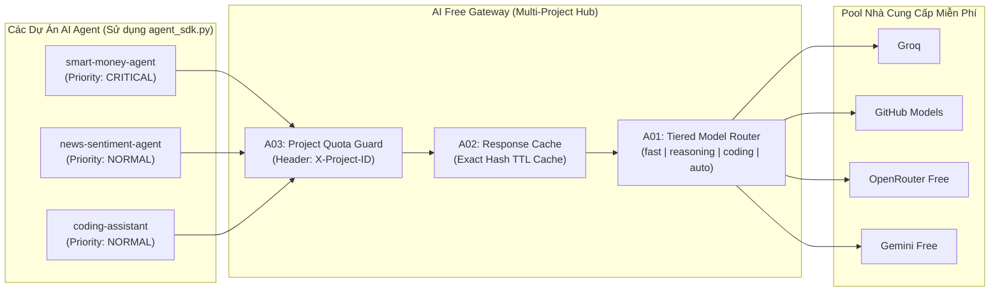

# ĐẶC TẢ KỸ THUẬT: HỆ SINH THÁI AI AGENT ĐA DỰ ÁN (UNIVERSAL AI AGENT HUB & SDK)

**Phiên bản:** 1.0  
**Mục tiêu:** Biến `ai-free-gateway` thành trung tâm điều phối AI 24/7 cho nhiều dự án AI Agent cùng lúc (Trading Bot, Telegram/Discord Bot, Scraper/News Agent, Coding Agent) với khả năng **tiết kiệm 80% quota**, **phân tầng model thông minh (Tiered Routing)**, **cách ly hạn mức theo dự án**, và **bộ SDK chuẩn hóa 1-file** để gắn vào bất kỳ dự án mới nào trong 30 giây.

---

## 1. BỐI CẢNH & VẤN ĐỀ CẦN GIẢI QUYẾT

Khi chạy nhiều dự án AI Agent cùng gọi vào một nguồn AI miễn phí (`ai-free-gateway`), sẽ phát sinh 4 vấn đề cốt lõi:
1. **Tranh chấp Quota (Noisy Neighbor):** Một dự án phụ (như bot đọc tin tức hoặc tool test) gọi liên tục làm cạn kiệt rate-limit (429) của Groq/OpenRouter, khiến dự án quan trọng (như `smart-money-agent` đang cần duyệt lệnh mua) bị thiếu tài nguyên.
2. **Lãng phí Request trùng lặp:** Nhiều agent hoặc nhiều chuärna quét gửi các prompt giống hệt nhau trong thời gian ngắn nhưng vẫn gọi ra provider bên ngoài.
3. **Chọn sai Model cho tác vụ:** Tác vụ phân loại JSON đơn giản lại gọi model 120B/Reasoning (chậm, tốn quota), trong khi tác vụ viết code/phân tích sâu lại rơi vào model nhỏ 8B.
4. **Lặp lại code boilerplate ở mỗi dự án:** Dự án nào cũng phải viết lại logic xử lý lỗi JSON, cắt chuỗi markdown ````json`, retry, timeout, gom batch, và chống lặp tool call.

---

## 2. KIẾN TRÚC TỔNG THỂ (4 HẠNG MỤC NÂNG CẤP A01 – A04)



---

## 3. CHI TIẾT KỸ THUẬT TỪNG HẠNG MỤC (DÀNH CHO AI / DEVELOPER THỰC THI)

### Hạng mục A01: Phân tầng Model theo Mục đích (Intent-Based Tiered Routing)
- **File mục tiêu:** `src/router/balancer.py`
- **Yêu cầu:**
  Ngoài `model="auto"`, hỗ trợ các bí danh (virtual model aliases) để các dự án Agent gọi theo nhu cầu thực tế:
  1. `model="fast"`: Ưu tiên tốc độ phản hồi < 1.5s và quota cao (ví dụ: `groq/openai/gpt-oss-20b`, `github/gpt-4o-mini`, `groq/qwen/qwen3.8-27b`, `gemini-2.5-flash`). Dùng cho phân loại nhanh, lọc dữ liệu, duyệt tín hiệu.
  2. `model="reasoning"`: Ưu tiên khả năng suy luận sâu, logic phức tạp, tranh biện (ví dụ: `groq/openai/gpt-oss-120b`, `openrouter/deepseek/deepseek-r1:free`, `github/Meta-Llama-3.1-70B-Instruct`).
  3. `model="coding"`: Ưu tiên các model chuyên viết code và gọi hàm/tool (ví dụ: `openrouter/qwen/qwen-2.5-coder-32b-instruct:free`, `github/gpt-4o-mini`, `groq/openai/gpt-oss-120b`).
  4. `model="long_context"`: Ưu tiên các model có context window >= 128k – 1M tokens (ví dụ: `gemini-2.5-flash`, `github/gpt-4o-mini`).
- **Logic thực thi trong `ModelBalancer.select_models`:**
  - Nếu `requested_model` nằm trong `{"auto", "fast", "reasoning", "coding", "long_context"}`, áp dụng bộ điểm cộng (tier bonus score) tương ứng cho từng nhóm model trước khi sắp xếp danh sách ứng viên.
  - Nếu nhóm ưu tiên hết model khả dụng, tự động fallback sang toàn bộ pool `"auto"` để không bao giờ bị gián đoạn.

---

### Hạng mục A02: Bộ nhớ đệm Phản hồi Thông minh (Deterministic Response Cache)
- **File mục tiêu:** `src/router/response_cache.py` (mới) và tích hợp vào `src/router/openai_proxy.py`.
- **Yêu cầu:**
  - Khi nhận request `POST /v1/chat/completions` có `stream=False` và `temperature <= 0.3` (các tác vụ phân tích, trích xuất JSON, chấm điểm của Agent):
  - Tính mã băm `SHA-256` từ `(requested_model, canonical_messages, canonical_tools, response_format)`.
  - Kiểm tra trong LRU Cache (tối đa 512 bản ghi, TTL mặc định 180 giây; có thể ghi đè qua header `X-Cache-TTL: <seconds>` hoặc tắt qua `X-Cache-TTL: 0`).
  - Nếu **Cache Hit**: Trả về ngay lập tức kết quả JSON hợp lệ trong `< 1ms`, kèm header `X-Gateway-Cache: HIT`, **không tốn bất kỳ request nào tới nhà cung cấp AI**.
  - Nếu **Cache Miss**: Gọi upstream bình thường, nếu thành công (200 OK và nội dung không rỗng) thì lưu vào cache và gắn header `X-Gateway-Cache: MISS`.

---

### Hạng mục A03: Quản lý & Bảo vệ Quota theo Dự án (Per-Project Quota & Priority Guard)
- **File mục tiêu:** `src/security/project_quota.py` (mới) và tích hợp vào `src/router/openai_proxy.py`, `src/main.py`.
- **Yêu cầu:**
  - Nhận diện dự án thông qua HTTP Header `X-Project-ID` (mặc định là `"default"` nếu không truyền).
  - Hỗ trợ 3 mức độ ưu tiên qua Header `X-Project-Priority`:
    - `critical` (ví dụ: `smart-money-agent`): Không bị giới hạn bởi bộ hãm mềm, luôn được dùng toàn bộ model tốt nhất.
    - `normal` (mặc định): Giới hạn mặc định 60 requests / phút (RPM).
    - `background` (ví dụ: cào dữ liệu, tóm tắt tin tức hàng loạt): Giới hạn 15 RPM để luôn nhường quota cho dự án `critical` và `normal`.
  - Cung cấp endpoint thống kê `GET /api/projects/stats` trả về số lượng request, cache hits, lỗi và độ trễ trung bình của từng dự án để theo dõi trên Dashboard.

---

### Hạng mục A04: Bộ SDK Chuẩn Hóa Cho Mọi Dự Án (`sdk/agent_sdk.py`)
- **File mục tiêu:** `sdk/agent_sdk.py` (file độc lập chỉ phụ thuộc vào `httpx` hoặc `openai`, có thể copy sang bất kỳ dự án nào).
- **Yêu cầu cung cấp 3 class cốt lõi:**
  1. **`UniversalAIClient`**:
     - Tự động gắn `X-Project-ID`, `X-Project-Priority`, `X-Cache-TTL`.
     - Phương thức `ask_text(prompt, system="", tier="auto", fallback="") -> str`.
     - Phương thức `ask_json(prompt, system="", tier="fast", fallback=None) -> dict`:
       - Tự động yêu cầu `response_format={"type": "json_object"}`.
       - Tự động làm sạch chuỗi nếu LLM bọc trong ````json ... ```` hoặc có văn bản thừa ở đầu/cuối.
       - Nếu lỗi parse hoặc lỗi mạng, tự động trả về `fallback` an toàn.
  2. **`BatchAIAgent`**:
     - Phương thức `process_batch(items: list, instruction: str, batch_size: int = 15) -> list`:
     - Tự động gom N mục nhỏ (ví dụ 15 tin tức hoặc 15 token) vào 1 lần gọi AI duy nhất và trả về mảng JSON tương ứng, giúp tiết kiệm 90–95% quota.
  3. **`ReActToolAgent`**:
     - Vòng lặp Agent gọi hàm (Tool-calling loop) có sẵn:
       - Giới hạn `max_steps = 5`.
       - Bộ phát hiện lặp lệnh (Client-side loop detector): Nếu Agent gọi cùng 1 hàm với cùng tham số 2 lần liên tiếp, tự động ngắt vòng lặp và buộc tổng hợp câu trả lời cuối cùng.

---

## 4. TIÊU CHÍ NGHIỆM THU (ACCEPTANCE CRITERIA)

1. **Kiểm thử Tiered Routing (`A01`):**
   - Gọi `model="fast"`, `model="reasoning"`, `model="coding"`, `model="long_context"` đều chọn đúng nhóm model mục tiêu và tự động fallback nếu nhóm đó đang cooldown.
2. **Kiểm thử Response Cache (`A02`):**
   - Gửi 2 request giống nhau liên tiếp với `temperature=0.1`: Request thứ 2 trả về `X-Gateway-Cache: HIT` mà không gọi ra mạng.
3. **Kiểm thử Project Quota (`A03`):**
   - Dự án gửi `X-Project-ID: scraper` với `X-Project-Priority: background` bị giới hạn đúng ngưỡng RPM, trong khi `X-Project-ID: smart-money-agent` (`critical`) vẫn đi qua bình thường.
   - Endpoint `GET /api/projects/stats` hiển thị đầy đủ thống kê theo từng dự án.
4. **Kiểm thử SDK (`A04`):**
   - `ask_json` bóc tách thành công JSON kể cả khi model trả về kèm markdown block ````json`.
   - `process_batch` gom nhóm và giải mã chính xác danh sách đầu vào.
   - `ReActToolAgent` thực thi tool và tự chặn khi phát hiện tool bị gọi lặp.
5. **Tương thích ngược 100%:** Toàn bộ các bài test hiện có của `ai-free-gateway` đều PASS.
